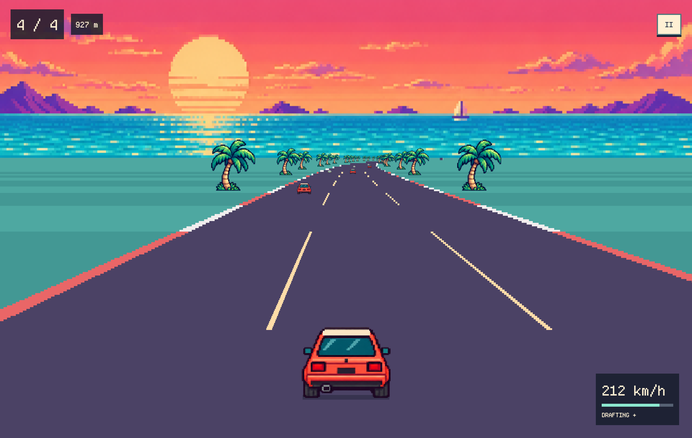

# Moonbounce

A tiny native macOS arcade racer. Chase three rivals through an endless pixel road trip, with one-kilometer sprints and an offline lo-fi radio.



**Race, drift, repeat.** Draft behind rivals, overtake and drift to earn boost. Sixteen routes and four handling styles are open from the start. Grass and contact cost momentum; your accumulated journey stays yours. While racing, the screen shows only position, distance, speed/boost and Pause.

## Run

Requires **macOS 14+** and **Go 1.27.1+**. Apple Silicon is verified; other platforms are not supported by this project.

```sh
git clone https://github.com/codingEzio/T-Moonbounce.git
cd T-Moonbounce
./run
```

To build a self-contained app:

```sh
./package
open .local/Moonbounce.app
```

The first build downloads pinned Go modules. The app includes its artwork, font and three music tracks and works offline. The locally built app is ad-hoc signed, not notarized.

## Controls

| Key | Action |
| --- | --- |
| ← → / A D | Steer |
| ↑ / W | Accelerate |
| ↓ / S | Brake |
| Shift + steering | Drift |
| Space | Spend energy on boost |
| Escape / P | Pause or resume; close a submenu first |
| C | Toggle cruise throttle |

Start in **Rally** with manual throttle, or choose Sunday, Cloud or Comet in Settings. Cruise handles the throttle; you steer. Hold or drag on the road for pointer steering.

Pause opens **Race · Route · Settings**. Settings includes English, 简体中文 and 繁體中文; Pixel/System typography; light/dark/system appearance; handling; and audio controls. System Reduce Motion keeps route browsing available without animation.

The radio plays **Windows Down**, **Keeping Cool** and **First Snow** by Holizna. Game pause and menus pause the music. Radio pause retains its position, Stop resets it, Replay starts from zero, and Next selects another track. See [music credits](assets/audio/CREDITS.md).

## Local data and privacy

No accounts, analytics, telemetry or runtime network requests. Normal app builds store the journey and preferences in `~/Library/Application Support/Moonbounce/settings.json`. `./run` uses the checkout's ignored `Local/settings.json`; `--state <path>` selects an explicit file. These are separate saves. To transfer a development save, close both instances and copy it to the app's data folder, keeping the original.

Saves are atomic and checked after writing. Previous valid saves and unreadable originals are retained for recovery. Race position and boost energy are session-local; distance, discoveries, passes, drift and preferences persist. Development caches, saves and private notes are excluded from Git.

## Development

Built with [MyGo](https://github.com/egoist/mygo) and Metal, [Oto](https://github.com/ebitengine/oto) for native audio, and [go-mp3](https://github.com/hajimehoshi/go-mp3). Rendering uses elapsed time and native display callbacks; there is no fixed 60 Hz simulation step.

```sh
go test ./...
go vet ./...
# Visible native check with real audio transport but zero output gain:
./run --mute-output --state .local/check.json --benchmark 18s --capture .local/check.png
# Opt-in CoreAudio transport check, also muted:
MOONBOUNCE_AUDIO_TEST=1 MOONBOUNCE_MUTE_OUTPUT=1 go test -run TestNativeAudioTransport -v
```

Native checks require a graphical macOS session. Ordinary tests do not open windows or play audio. GitHub Actions checks formatting, tests, vet and app packaging; it does not establish visual quality, physical refresh rate or listening quality. [Contributing](CONTRIBUTING.md).

## License and credits

Project code and original generated game art are offered under [MIT](LICENSE), to the extent applicable rights exist. The screenshot is an actual app capture, stored as lossless, metadata-free WebP.

Bundled music is **CC0**. The modified font and its component notices retain their own licenses; they are not relicensed under MIT. Dependency notices, provenance and image-generation prompts are included. See [dependencies and assets](DEPENDENCIES.md), [font notices](assets/fonts/NOTICE.md) and [art prompts](assets/PROMPTS.md).

## 简体中文

Moonbounce 是一款原生 macOS 像素赛车游戏：每公里一场竞速，三位对手，16 条开放路线，四种驾驶手感和离线 lo-fi 电台。跟车、漂移与超车积累加速能量；草地和碰撞影响速度，不会清空行程。

运行 `./run`，或用 `./package` 构建应用。方向键驾驶，Shift 漂移，空格加速，Esc 暂停，C 切换巡航。暂停菜单提供路线与设置。支持简体中文、繁体中文、英文，以及像素/系统字体和浅色/深色主题。无需账号，没有遥测；数据保存在本机。代码和原创生成美术使用 MIT，音乐与字体保留各自授权。

## 繁體中文

Moonbounce 是一款原生 macOS 像素賽車遊戲：每公里一場競速，三位對手，16 條開放路線，四種駕駛手感與離線 lo-fi 電台。跟車、漂移與超車累積加速能量；草地與碰撞影響速度，不會清空行程。

執行 `./run`，或用 `./package` 建置應用程式。方向鍵駕駛，Shift 漂移，空白鍵加速，Esc 暫停，C 切換巡航。暫停選單提供路線與設定。支援簡體中文、繁體中文、英文，以及像素/系統字體與淺色/深色主題。無需帳號，沒有遙測；資料儲存在本機。程式碼與原創生成美術使用 MIT，音樂與字體保留各自授權。
